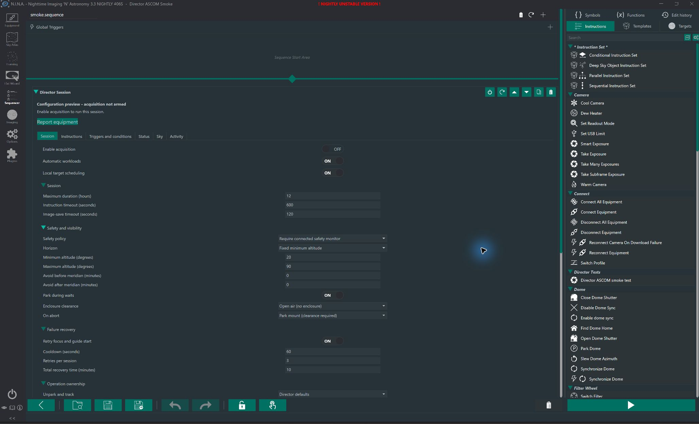
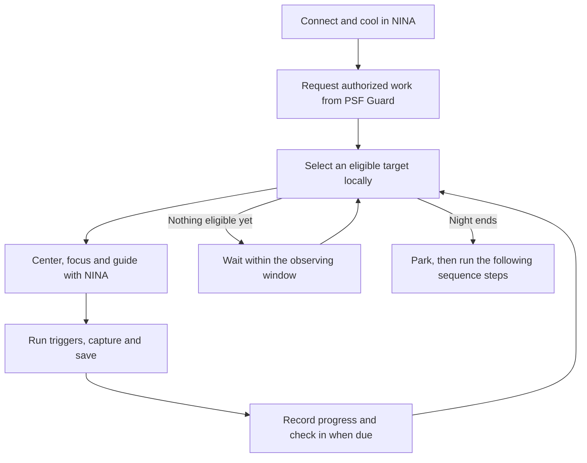
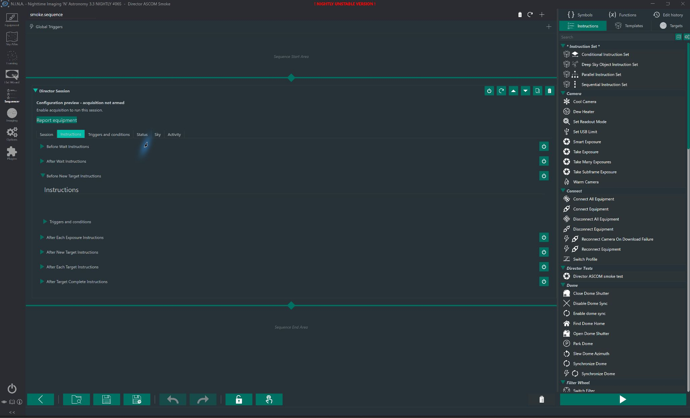
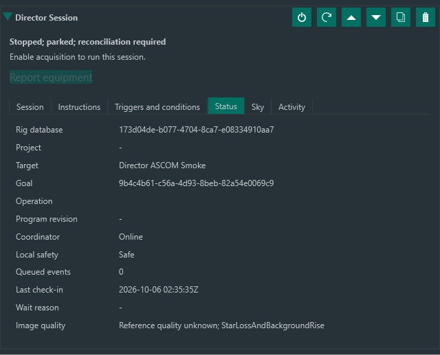
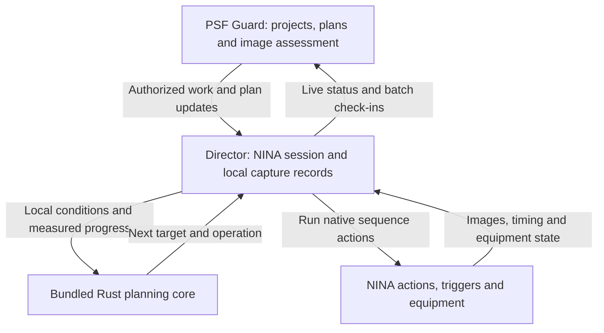

# PSF Guard Director for N.I.N.A.

**Beta.** Installable from the PSF Guard plugin source in NINA 3.2 or 3.3.

**Plan in PSF Guard. Image in N.I.N.A.** Director runs your observing projects
through NINA's Advanced Sequencer. It chooses what to image next, prepares the
equipment, captures frames, and reports progress back to
[PSF Guard](https://psf-guard.com).

Director schedules locally using the same Rust planning core as PSF Guard. It
follows project priorities, target visibility, your horizon, Moon avoidance and
remaining exposure goals. It can keep imaging through a server outage within
the work already authorized, then check in when the connection returns.

*Director Session in an unarmed NINA simulator profile. Recovery settings shown
here are configured for that test; retries are off by default.*

## What it does

- **Schedules multiple targets locally.** Selects eligible work by priority and
  observing constraints instead of replaying a fixed list of exposures.
- **Uses NINA's imaging actions.** Slew and center, rotate, autofocus, guide,
  dither, flip at the meridian, capture and park using your connected equipment.
- **Fits into your sequence.** Use Director's automatic actions or your own
  NINA instructions, triggers and conditions in the target and exposure slots.
- **Shows what is happening.** Session status, a target altitude/horizon chart,
  and an action log show the selected work, waits, outcomes and elapsed time.
- **Checks in live or in batches.** Send rig status while connected and deliver
  recorded capture and preparation results during the night or afterward.
- **Keeps safety local.** Safety-monitor and roof status interrupt acquisition.
  The default abort action parks the mount when enclosure clearance permits.
  Recovery confirms idle equipment and obtains fresh work before imaging again.

Target Scheduler is not required. Director is a separate plugin from
[PSF Guard Sync](https://github.com/theatrus/psf-guard-nina-plugin): Sync transfers
catalog data and images; Director runs acquisition. Installing Director does not
change Sync.

## Get started

Requires **Windows x64**, **NINA 3.2 or 3.3**, and a PSF Guard server
with Director support. The planning runtime is bundled with the plugin.

1. Add `https://nina-plugins.psf-guard.com/` as a source in NINA's plugin manager
   and install **PSF Guard Director**. See [releases](https://github.com/theatrus/psf-guard-director-nina-plugin/releases)
   for package versions. This README describes `main`; packaged features follow
   the release notes.
2. In Director's plugin settings, open **Coordinator**. Enter your PSF Guard
   server address and the Director pairing code that begins with `psfdpt_`,
   then click **Pair**. Issue the code for your rig using the
   [PSF Guard Director pairing API](https://github.com/theatrus/psf-guard/blob/main/docs/DIRECTOR.md#pair-a-director-client).
   Credentials stay in Windows Credential Manager.
3. Connect your equipment, add **Director Session** to the Advanced Sequencer,
   and configure safety, enclosure clearance, horizon and operation ownership.
   Keep acquisition disabled while setting up.
4. Activate the plans you want on the rig in PSF Guard. Director reports the
   connected equipment automatically when the session starts. The server
   applies the report without an approval step and preserves work permission.
5. Turn on **Enable acquisition**. Run the sequence to request work from
   PSF Guard, select targets and start imaging. Director always requests work
   automatically and selects targets from the assigned workload.

Before a run, Director Session shows whether acquisition is off or has not
started. With **Enable acquisition** on, start the sequence to check equipment
and permission to image. There is no separate arm button. The summary describes
how Director gets work; it does not confirm server approval.

Put connect/cool steps before Director and warm/disconnect steps after it in the
outer NINA sequence. Pairing and equipment reporting alone never start acquisition.
See the [setup and operation guide](docs/native-capture.md) for policy details.

## A night with Director

Safety and enclosure checks run throughout the sequence, not just between
exposures. A server outage does not disable local checks or grant more work.
When the current authorization expires, Director needs fresh server approval.

### Your instructions, where you need them

The seven slots are **Before Wait**, **After Wait**, **Before New Target**,
**After Each Exposure**, **After New Target**, **After Each Target**, and
**After Target Complete**. Use the native editors to add NINA instructions and
compatible plugin actions. Under **Settings → Operation ownership**, choose
**Sequence instructions / triggers** for each operation you want your own
instructions or triggers to run. N.I.N.A. also evaluates triggers from
enclosing instruction sets. When acquisition is enabled, Director shows the
location of any overlapping instruction or trigger before the session runs.

Both the plugin page and the session open with current status. The plugin page
also shows instructions running before or after Director Session, even with
server activity reporting switched off. Running local or inherited N.I.N.A.
triggers take precedence over the upcoming exposure in the session, toolbar,
and live PSF Guard status, including triggers that do not send progress messages.
The session header shows the current action and target. **Overview** adds only
safety, image quality, and connection status. Technical identifiers, saved-record
details, and the manual equipment-report action are under its collapsed
**Diagnostics** section; equipment is reported automatically at session start.

Under **Settings → Autofocus**, choose **Autofocus when starting a target** and
**Autofocus after a filter change** independently. Both stay enabled for existing
sequences. These settings apply to Director-owned autofocus; choose **Sequence
instructions / triggers** for custom autofocus, including Inject Autofocus.
The trigger editors use N.I.N.A.'s full Advanced Sequencer controls. Runtime
start/stop controls are under **Advanced and diagnostics** on the plugin page;
normal sequences start the planner automatically.

### Recovery is your choice

Cloud screening, inline focus/guide retries and weather/roof holds are **off by
default**. Unsafe conditions stop the night and park when the enclosure permits
it. Automatic recovery of technical failures preserves the current Run's
duration limit and does not override a stop-for-night policy.

Optional recovery has time and attempt limits. Cloud screening can monitor,
stop for the night, or hold and take unsaved probe exposures. Its initial
reference keeps a **Reference quality unknown** warning: stable frames do not
prove a clear sky. Repeated autofocus or guiding failures can accompany clouds,
but Director stops on exhausted retries without needing a cloud diagnosis.

*Native NINA status-view render from the simulator test, with controlled quality
measurements. The unknown-reference warning remains visible after parking.*

On a new Run or an acquisition failure, Director confirms the camera is idle,
stops mount motion and guiding, delivers saved receipts, and retires the previous
assignment. It keeps images and history, then requests fresh work using current
image counts. Old observing-night records no longer require manual removal.
Automatic retries keep the current Run's original maximum-duration deadline.
See [automatic session recovery](docs/native-capture.md#automatic-session-recovery).

## How it fits together

PSF Guard and Director use the same planning code. NINA owns equipment actions;
Director does not need Target Scheduler internals or an always-online scheduler.
Local records survive disconnection, and repeated check-ins do not duplicate
capture credit or replay equipment actions. Check-ins transfer evidence, not
image files.

## AstroCollab

Director can register its own rig with an
[AstroCollab server](https://github.com/theatrus/astrocollab-api) using a pairing
code or browser sign-in. In plugin settings, expand **Standalone collaboration**
to connect. This connection is separate from PSF Guard pairing.
Credentials stay in Windows Credential Manager; only remote
identity and connection state are stored in the NINA profile. Deleting a
credential retains the original agent. **New connection** explicitly registers
a different agent; it does not recover or relabel the old agent's work.

The [interoperability design](https://github.com/theatrus/psf-guard/blob/main/docs/design/collaboration.md)
maps AstroCollab's Starfront-compatible hello, tonight and report protocol to
two modes: plugin-only acquisition through the bundled Rust sidecar, or import
into PSF Guard's existing projects and rig databases. Both use the same
planning core, NINA actions and trigger hooks. Plugin-only mode would need a
reviewed local workload policy; direct authentication alone does not supply
acquisition authority. The current plugin still requires PSF Guard
pairing and an allocation to begin acquisition.

Local priorities, safety, equipment limits and bounded acquisition permission
would remain in control. Durable reports would retain panel, capture, quality
and calibration provenance, with one reporting owner per rig/share. Remote
verdicts would appear alongside local grades, not overwrite them. Raw captures
would not be labeled calibrated without processing evidence.

A paired Director uploads the lights its sessions capture to the paired PSF
Guard database when you enable **Upload captured frames to PSF Guard** (off by
default) and the database has **Image uploads** on. Live image record delivery
works independently of file uploads; see
[Image uploads](docs/native-capture.md#image-uploads). Corrections to previously
credited data need further protocol work; this roadmap does not promise that
feature today.

## Documentation and development

- [Setup, native actions, safety and check-ins](docs/native-capture.md)
- [Simulator validation and known test limits](docs/nina-smoke-test.md)
- [Build, test and package the plugin](docs/development.md)
- [Director architecture and roadmap](https://github.com/theatrus/psf-guard/blob/main/docs/design/director.md)

Cloud control flow has simulator coverage; real-sky cloud accuracy and arbitrary
crash recovery remain validation work. Test your equipment and safety policies
under supervision before unattended use.

## License

Apache-2.0. Copyright 2026 Yann Ramin (@theatrus).
